# Golfcart Folierung: Modelle und Karosserieformen
[English](README.md) | [Deutsch](README.de.md) | [Français](README.fr.md) | [Italiano](README.it.md) | [Polski](README.pl.md) | [日本語](README.ja.md)

Vergleiche 34 Golfcart Modelle und Karosseriekonfigurationen von sieben Marken. Sitzanordnung, Fahrhöhe, vorhandene Dachangaben und Referenzjahre stammen aus dem Katalog. Dazu kommen Glanz, Matt, Chrom und holografische Oberflächen.

| | | | |
|:---:|:---:|:---:|:---:|
| 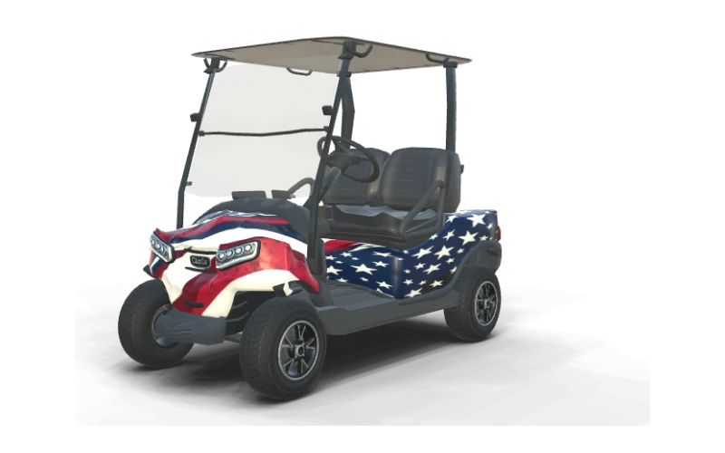 Club Car Onward 2 Passenger | 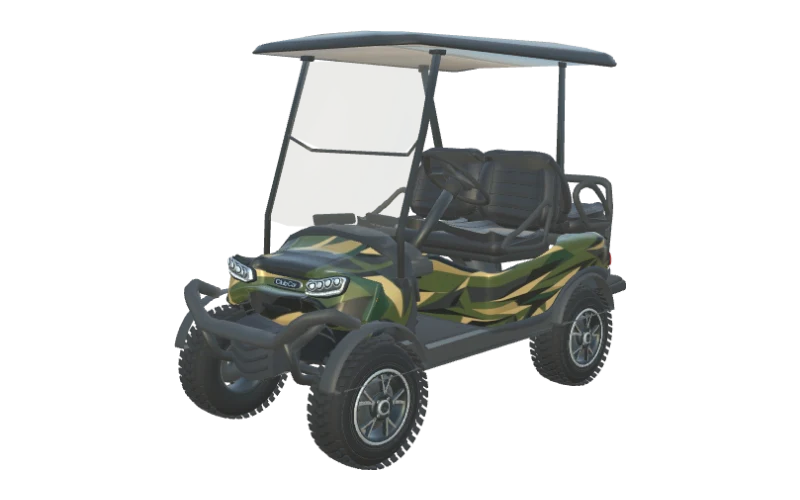 Club Car Onward Lifted 4 Passenger | 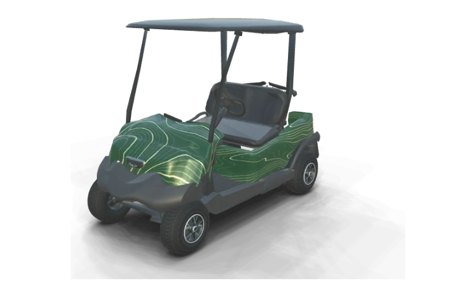 Club Car Tempo | 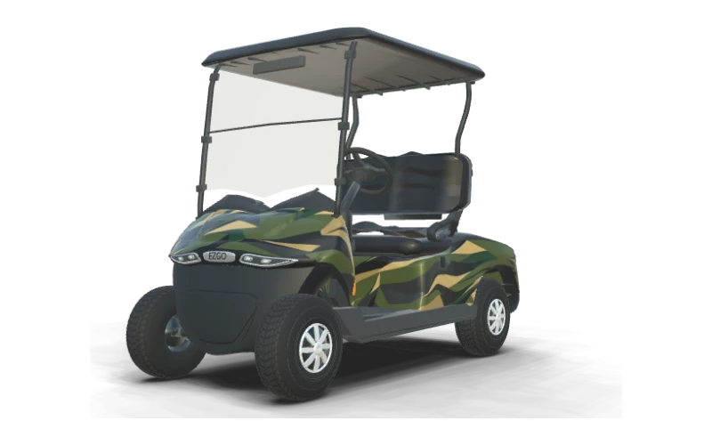 E-Z-GO RXV 2 Freedom ELiTE Lithium |
| 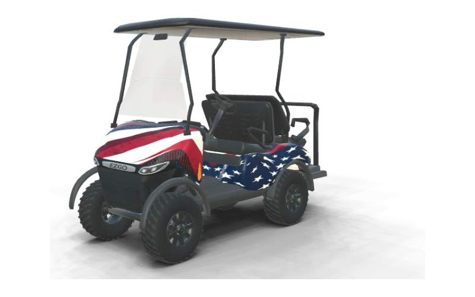 E-Z-GO RXV 4 Summit X ELiTE Lithium | 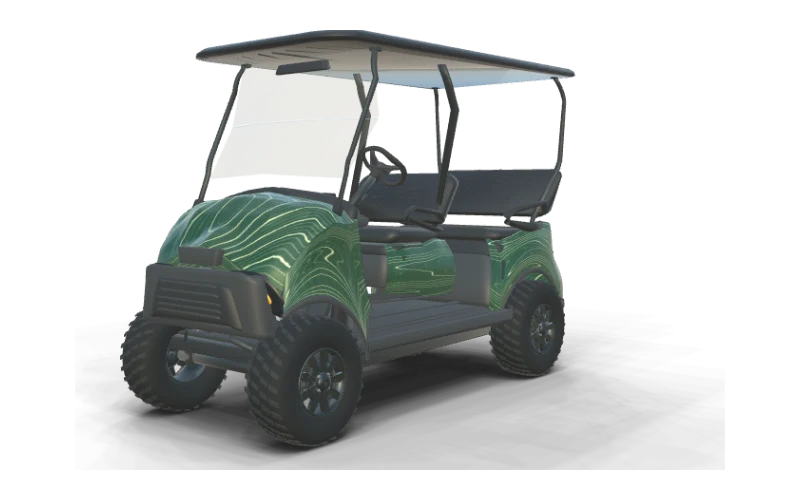 E-Z-GO Liberty Summit X ELiTE Lithium | 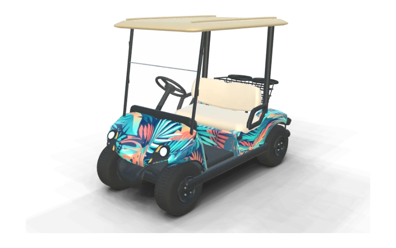 Yamaha Drive² PTV QuieTech EFI | 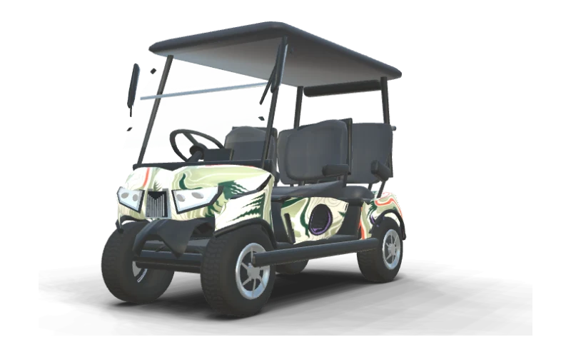 Evolution D5 Ranger 4 Plus |
| 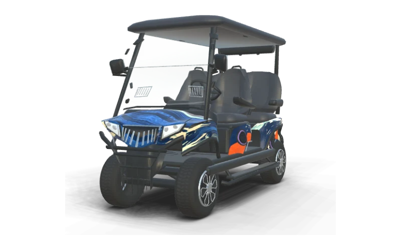 Evolution D5 Maverick 4 Plus | 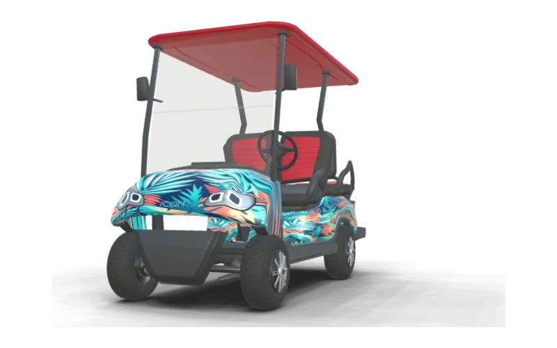 ICON i40 Standard | 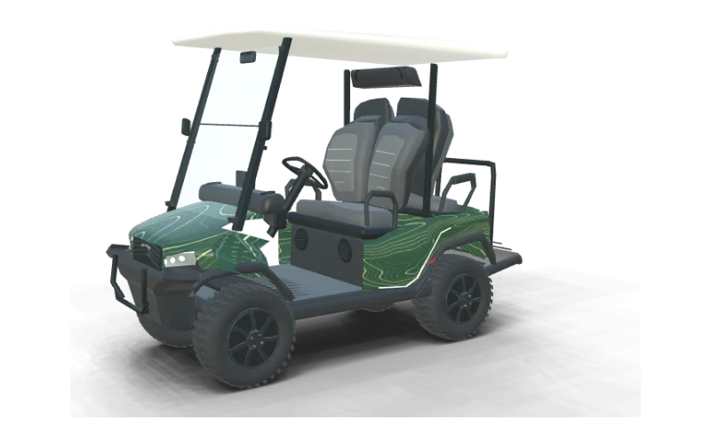 Bintelli Beyond 4PR Lifted | 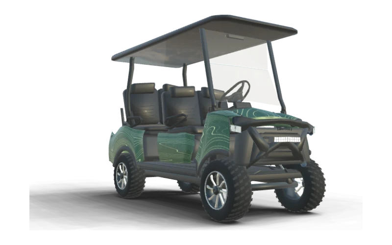 Denago EV Rover XL |

## Files

| File | Inhalt |
|---|---|
| [MODELS.md](MODELS.md) | Karosseriekonfigurationen nach Marke |
| [models.json](models.json) | Bereinigter Referenzkatalog mit 34 Modellen |
| [index.html](index.html) | Interaktive GitHub Pages Referenz mit Markenfilter und Suche |
| [models.go](models.go) | Go Paket mit eingebetteten Daten und Suchfunktionen |

## Umfang der Referenz

Der Katalog beschreibt sichtbare Karosseriekonfigurationen. Er enthält keine physischen Maße, DPI Angaben oder Produktionsschnittvorlagen. Referenzjahre belegen keine Austauschbarkeit.

## Related

Ich habe [Golf Cart Wraps](https://golfcart-wraps.com/de) entwickelt, damit Besitzer Designs auf ihrem Cart ausprobieren können. Vergleiche hier die Karosserieformen und [teste dein Muster im 3D Designer](https://golfcart-wraps.com/design?utm_source=github&utm_medium=referral&utm_campaign=open_reference).

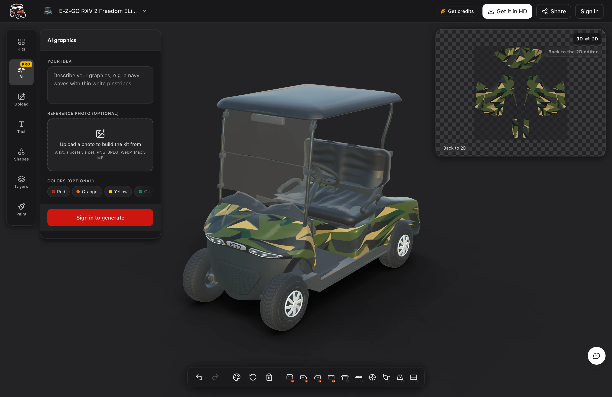

Vergleiche Motive, Karosserieteile und Oberflächen am ausgewählten Cart.
