# Habillage de voiturette de golf: modèles et carrosseries
[English](README.md) | [Deutsch](README.de.md) | [Français](README.fr.md) | [Italiano](README.it.md) | [Polski](README.pl.md) | [日本語](README.ja.md)

Comparez 34 modèles et configurations de voiturettes de sept marques. Les sièges, la hauteur, les détails de toit disponibles et les années de référence proviennent du catalogue. Quatre finitions sont présentées: brillante, mate, chromée et holographique.

| | | | |
|:---:|:---:|:---:|:---:|
| 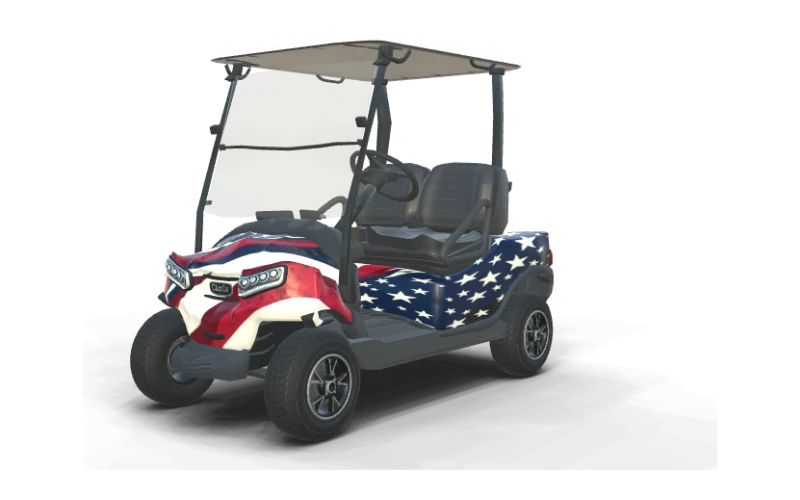 Club Car Onward 2 Passenger | 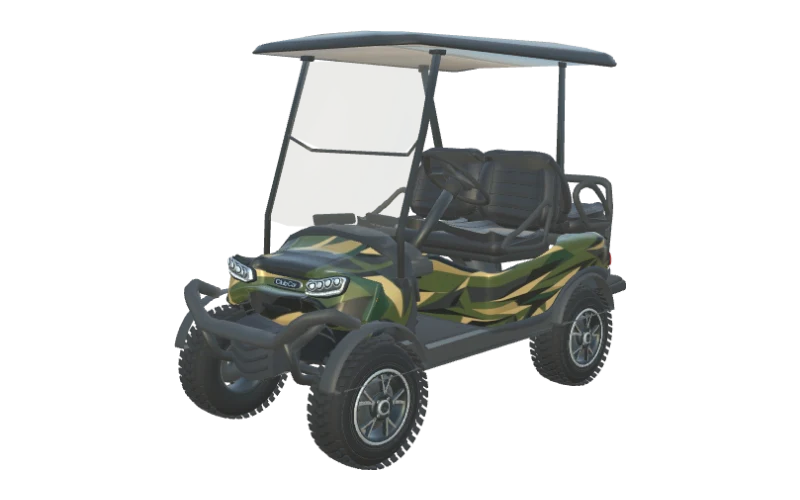 Club Car Onward Lifted 4 Passenger | 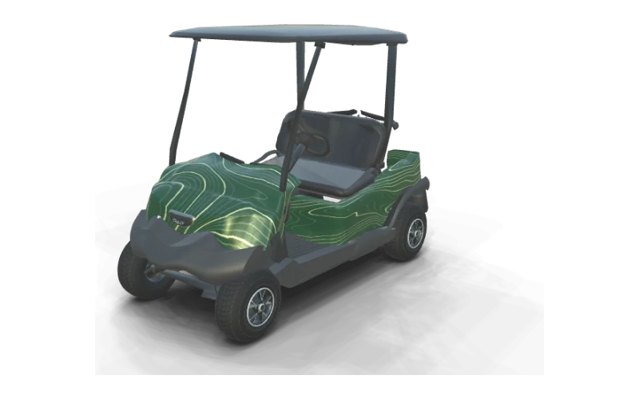 Club Car Tempo | 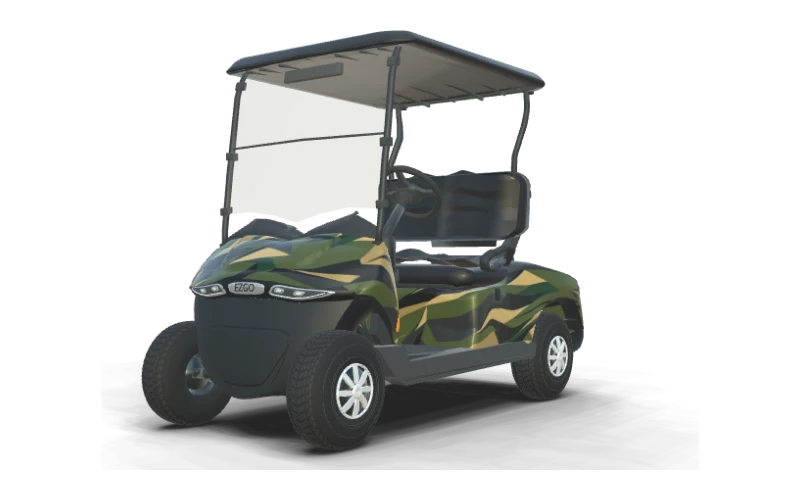 E-Z-GO RXV 2 Freedom ELiTE Lithium |
| 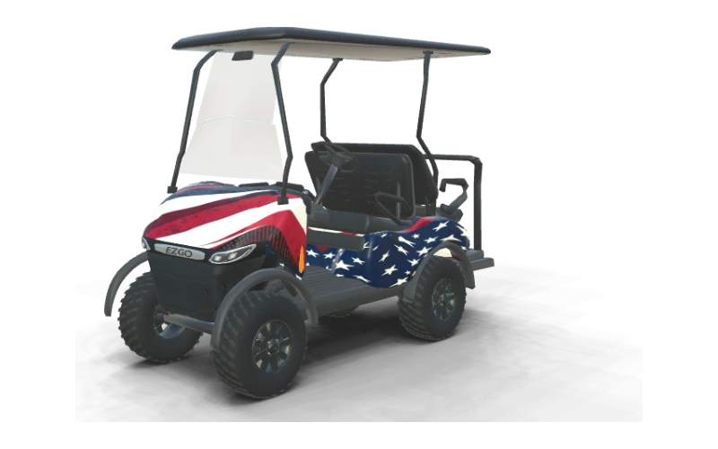 E-Z-GO RXV 4 Summit X ELiTE Lithium | 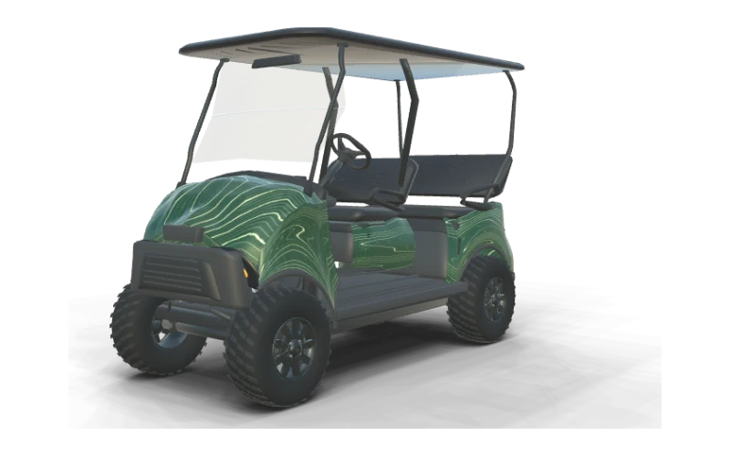 E-Z-GO Liberty Summit X ELiTE Lithium | 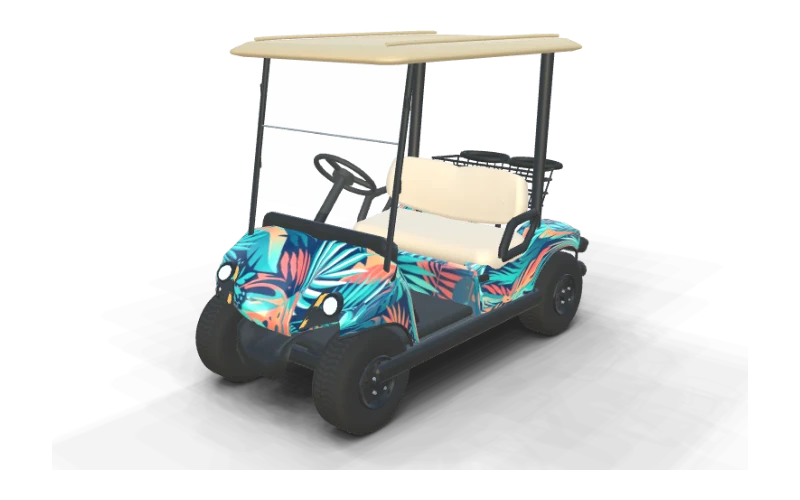 Yamaha Drive² PTV QuieTech EFI | 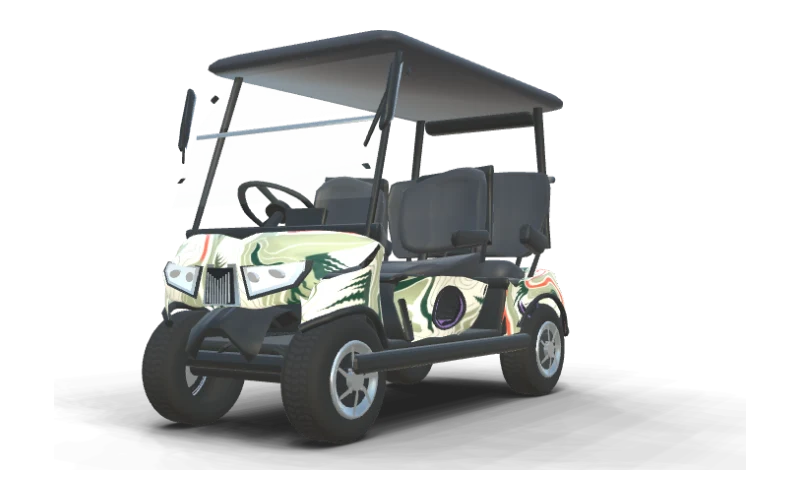 Evolution D5 Ranger 4 Plus |
| 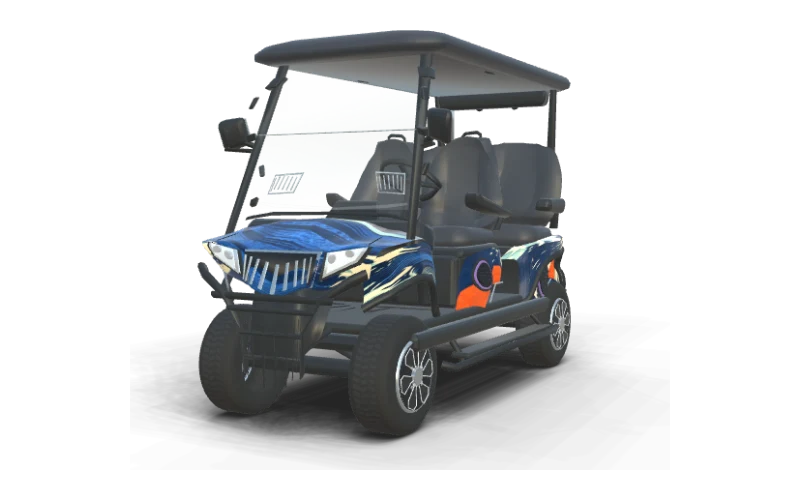 Evolution D5 Maverick 4 Plus | 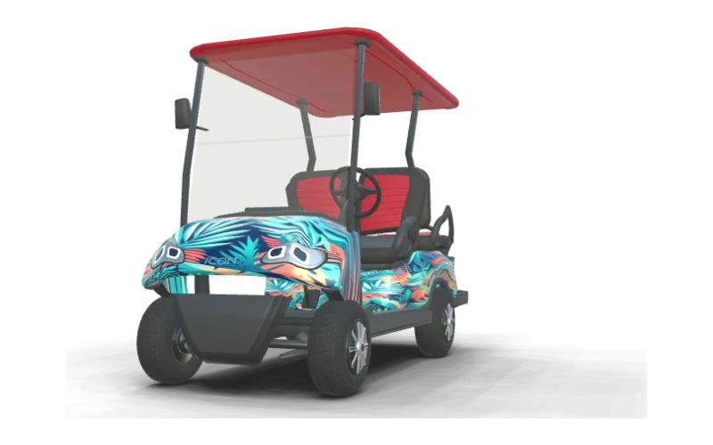 ICON i40 Standard | 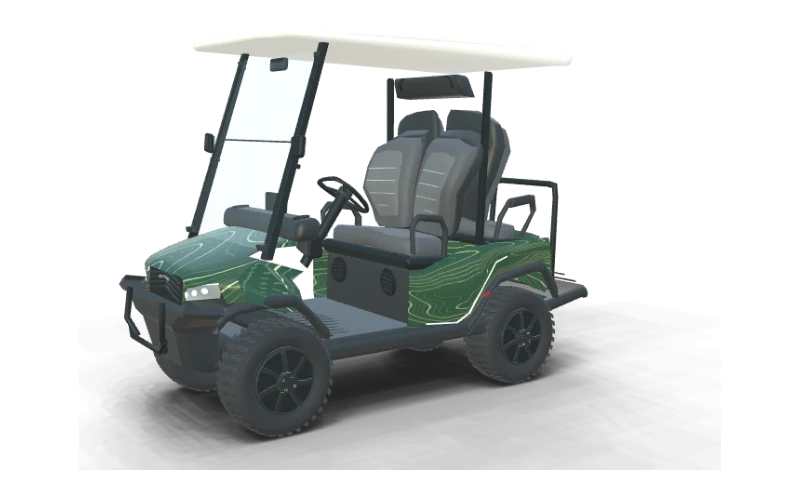 Bintelli Beyond 4PR Lifted | 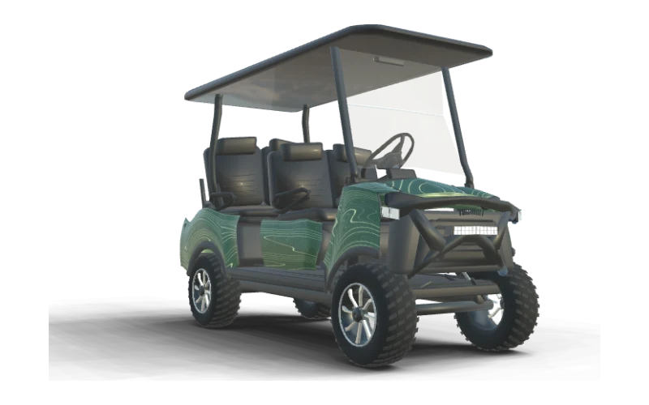 Denago EV Rover XL |

## Files

| File | Contenu |
|---|---|
| [MODELS.md](MODELS.md) | Configurations de carrosserie par marque |
| [models.json](models.json) | Catalogue de référence épuré de 34 modèles |
| [index.html](index.html) | Référence interactive GitHub Pages avec filtre par marque et recherche |
| [models.go](models.go) | Module Go avec données intégrées et fonctions de recherche |

## Portée de la référence

Le catalogue décrit des configurations visuelles. Il ne fournit ni dimensions physiques, ni résolution DPI, ni gabarits de découpe pour la production. Les années de référence ne prouvent pas la compatibilité des panneaux.

## Related

J’ai créé [Golf Cart Wraps](https://golfcart-wraps.com/fr) pour aider les propriétaires à explorer des motifs sur leur voiturette. Comparez les carrosseries ici, puis [essayez votre motif dans le concepteur 3D](https://golfcart-wraps.com/design?utm_source=github&utm_medium=referral&utm_campaign=open_reference).

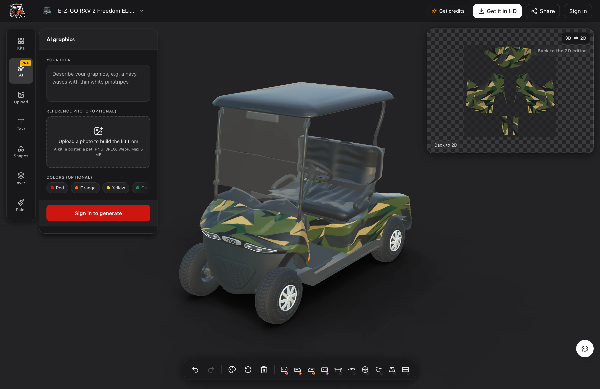

Comparez les motifs, les panneaux et les finitions sur la voiturette choisie.
