# Pellicole per golf cart: modelli e carrozzerie
[English](README.md) | [Deutsch](README.de.md) | [Français](README.fr.md) | [Italiano](README.it.md) | [Polski](README.pl.md) | [日本語](README.ja.md)

Confronta 34 modelli e configurazioni di golf cart di sette marchi. Sedili, altezza, dettagli del tetto disponibili e anni di riferimento provengono dal catalogo. Sono incluse le finiture lucida, opaca, cromata e olografica.

| | | | |
|:---:|:---:|:---:|:---:|
| 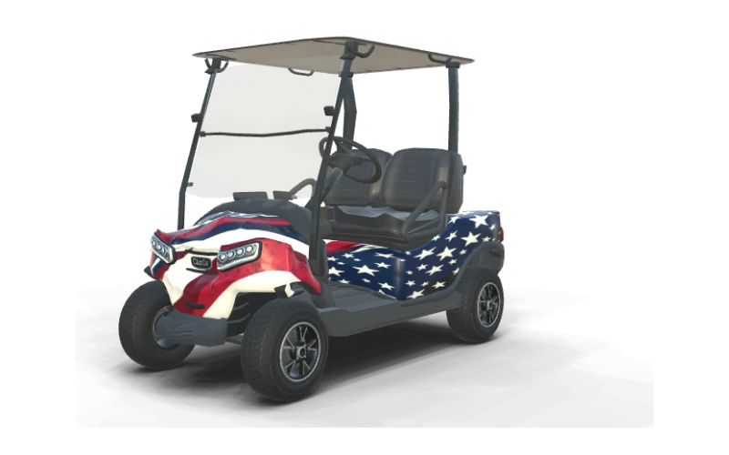 Club Car Onward 2 Passenger | 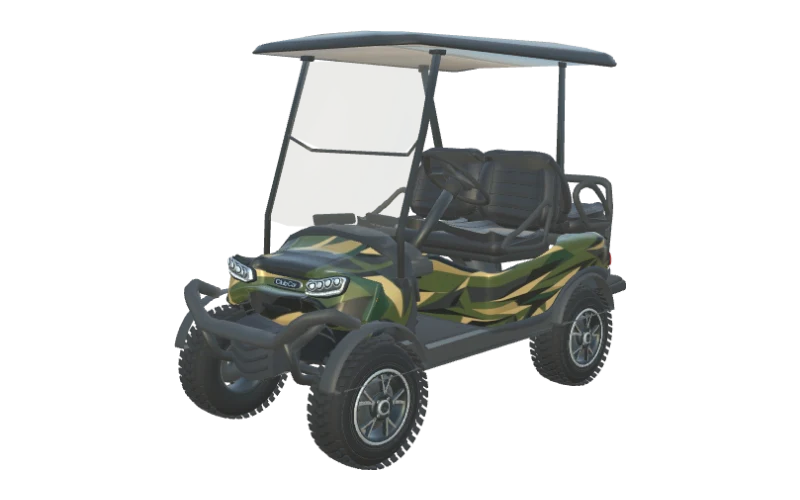 Club Car Onward Lifted 4 Passenger | 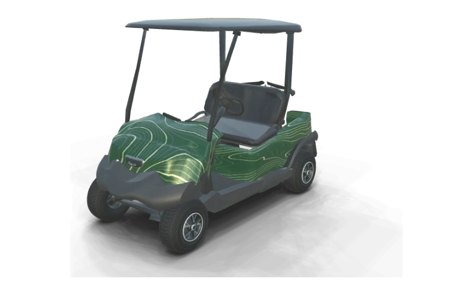 Club Car Tempo | 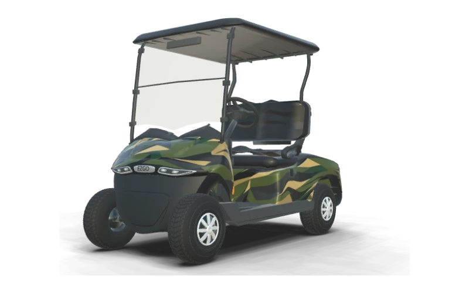 E-Z-GO RXV 2 Freedom ELiTE Lithium |
| 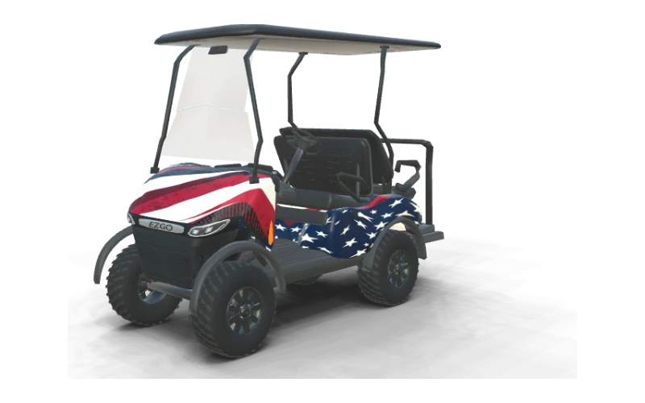 E-Z-GO RXV 4 Summit X ELiTE Lithium | 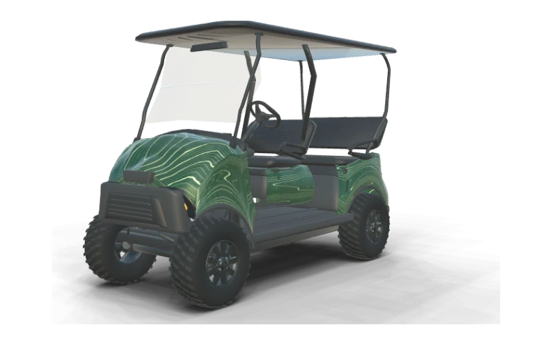 E-Z-GO Liberty Summit X ELiTE Lithium | 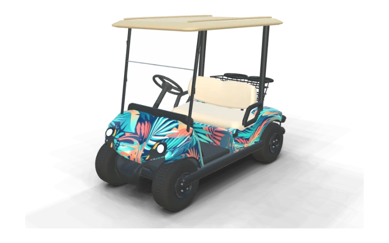 Yamaha Drive² PTV QuieTech EFI | 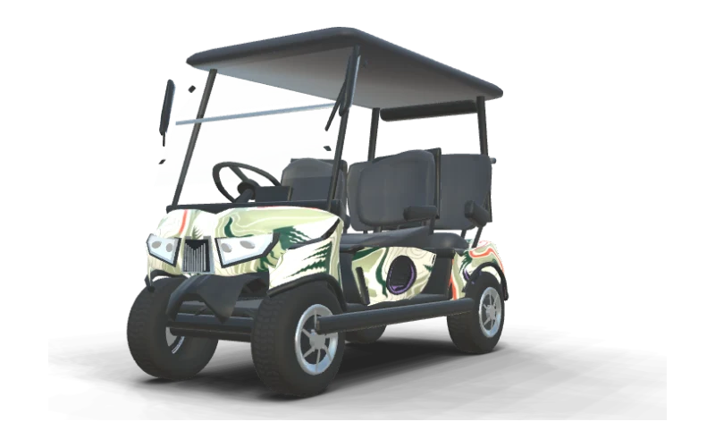 Evolution D5 Ranger 4 Plus |
| 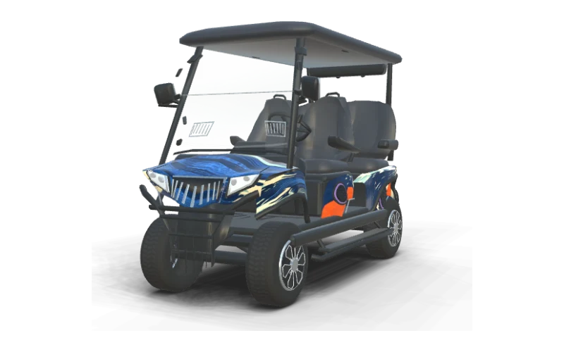 Evolution D5 Maverick 4 Plus | 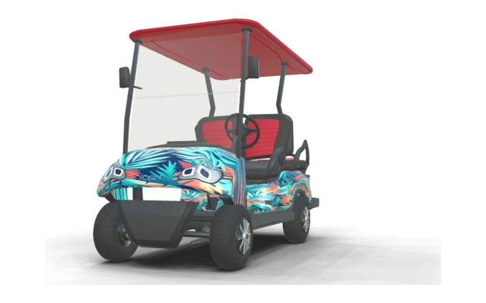 ICON i40 Standard | 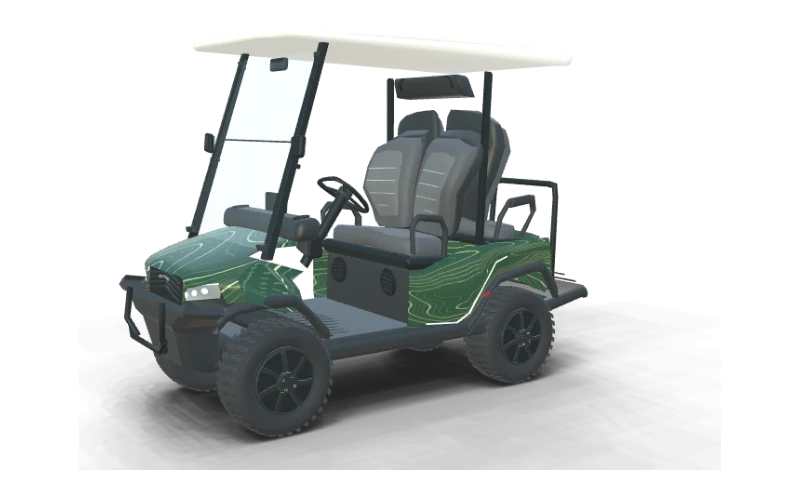 Bintelli Beyond 4PR Lifted | 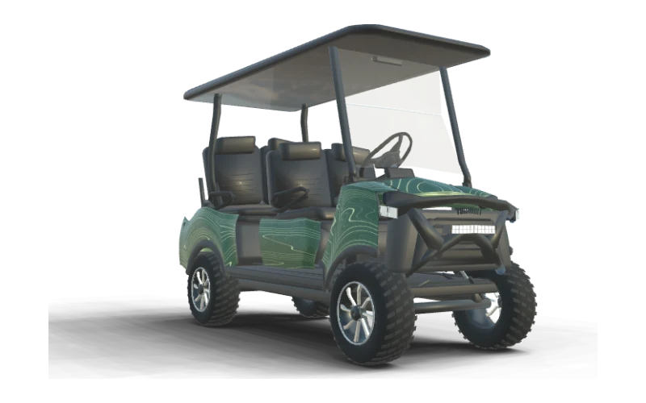 Denago EV Rover XL |

## Files

| File | Contenuto |
|---|---|
| [MODELS.md](MODELS.md) | Configurazioni della carrozzeria per marchio |
| [models.json](models.json) | Catalogo di riferimento con 34 modelli |
| [index.html](index.html) | Riferimento interattivo GitHub Pages con filtro per marchio e ricerca |
| [models.go](models.go) | Pacchetto Go con dati incorporati e funzioni di ricerca |

## Ambito del riferimento

Il catalogo descrive configurazioni visive. Non contiene dimensioni fisiche, specifiche DPI o sagome di taglio per la produzione. Gli anni di riferimento non dimostrano la compatibilità dei pannelli.

## Related

Ho creato [Golf Cart Wraps](https://golfcart-wraps.com) per aiutare i proprietari a esplorare le grafiche sul proprio cart. Confronta le carrozzerie e [prova il tuo motivo nel designer 3D](https://golfcart-wraps.com/design?utm_source=github&utm_medium=referral&utm_campaign=open_reference).

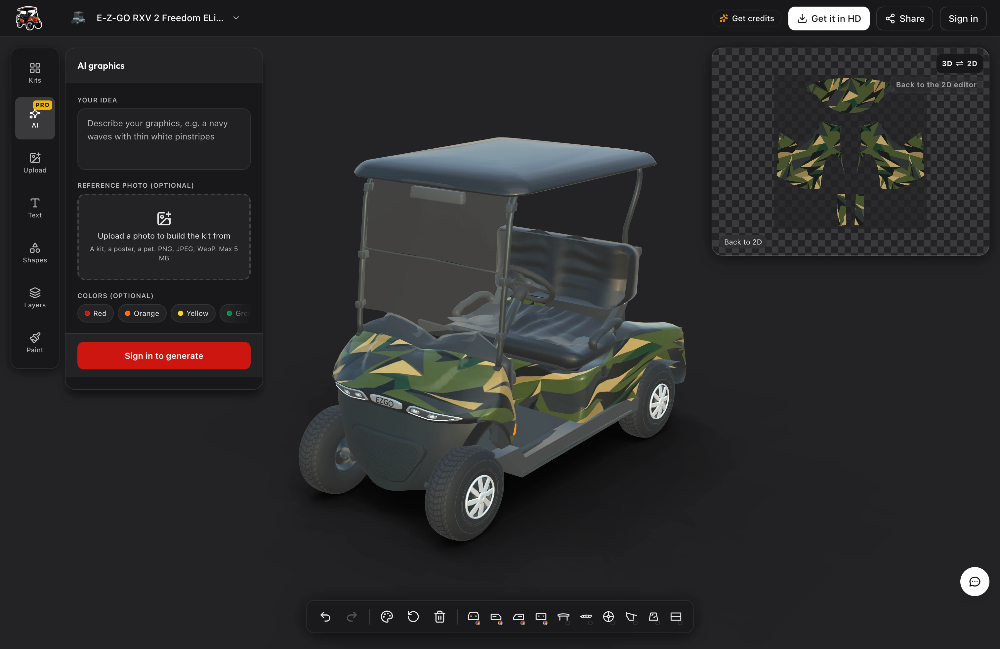

Confronta grafiche, pannelli e finiture sul cart selezionato.
