# ゴルフカートラップ: 車種とボディ形状の資料
[English](README.md) | [Deutsch](README.de.md) | [Français](README.fr.md) | [Italiano](README.it.md) | [Polski](README.pl.md) | [日本語](README.ja.md)

7ブランド、34車種のボディ構成を比較できます。座席配置、車高、記録のあるルーフ情報と参照年式をカタログから収録しています。グロス、マット、クローム、ホログラフィックの仕上げも紹介します。

| | | | |
|:---:|:---:|:---:|:---:|
| 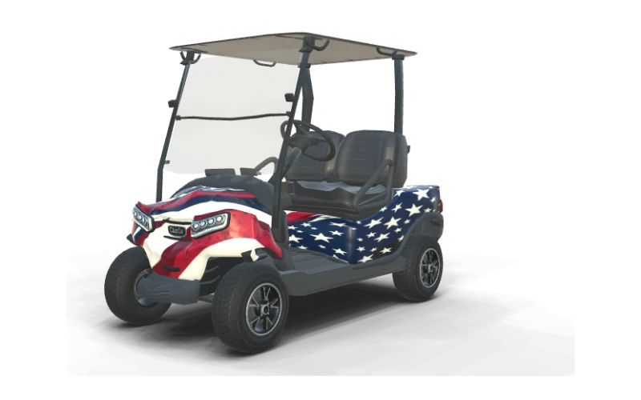 Club Car Onward 2 Passenger | 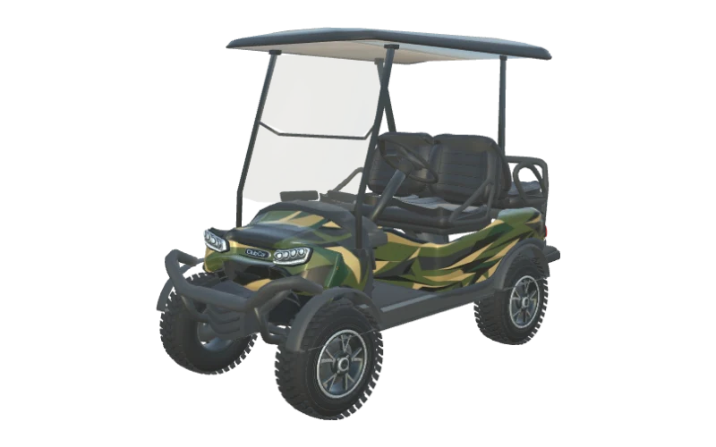 Club Car Onward Lifted 4 Passenger | 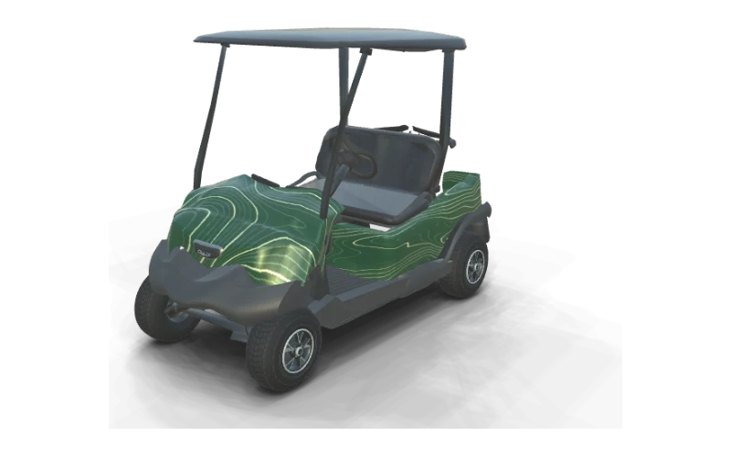 Club Car Tempo | 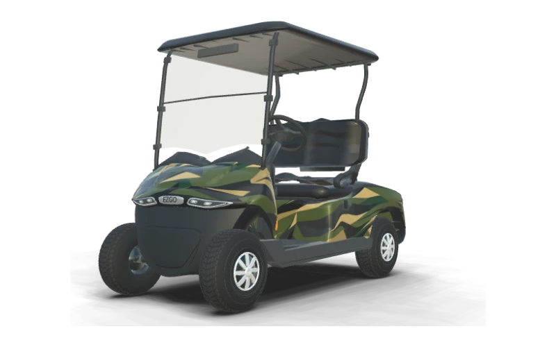 E-Z-GO RXV 2 Freedom ELiTE Lithium |
| 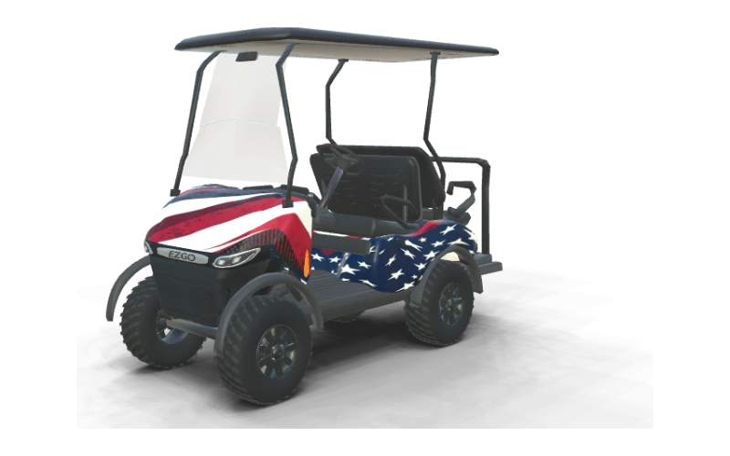 E-Z-GO RXV 4 Summit X ELiTE Lithium | 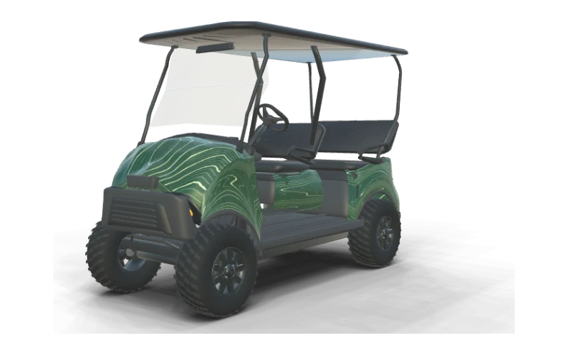 E-Z-GO Liberty Summit X ELiTE Lithium | 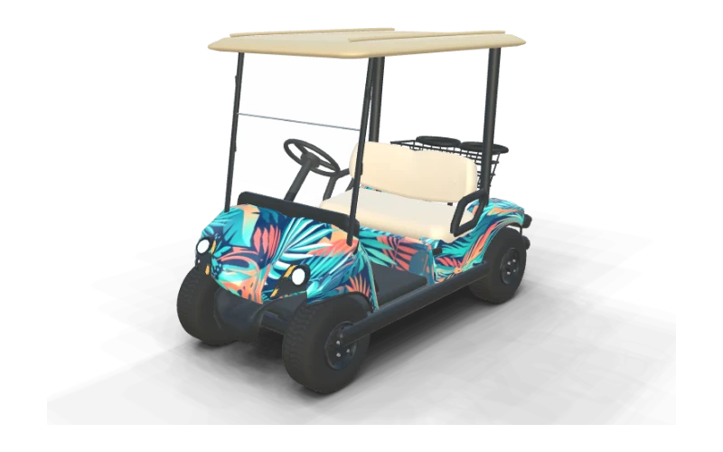 Yamaha Drive² PTV QuieTech EFI | 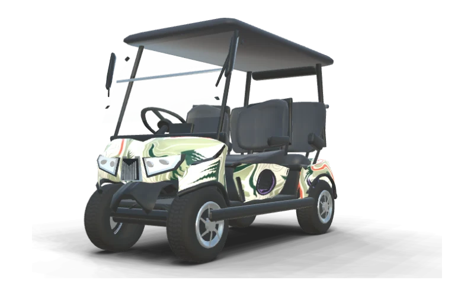 Evolution D5 Ranger 4 Plus |
| 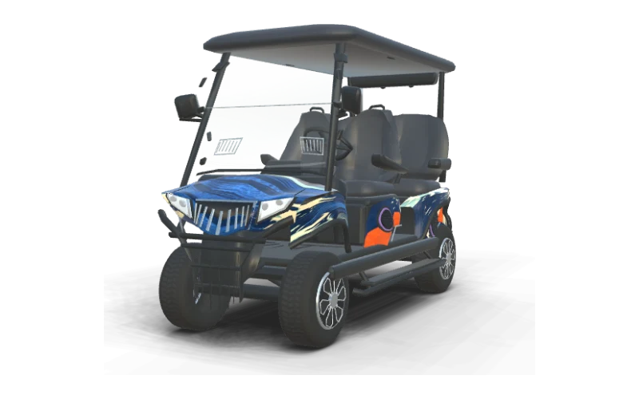 Evolution D5 Maverick 4 Plus | 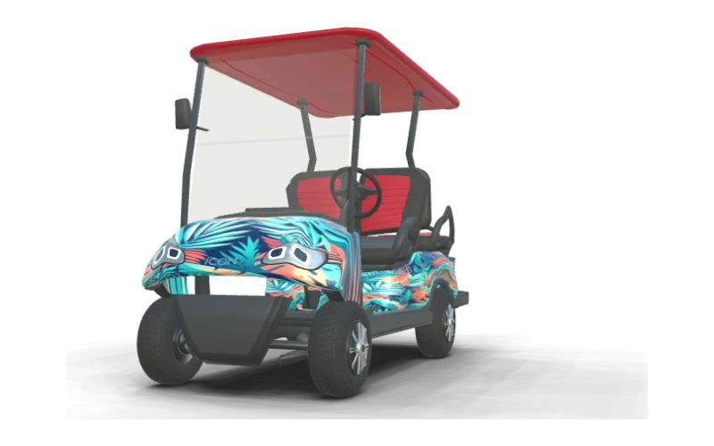 ICON i40 Standard | 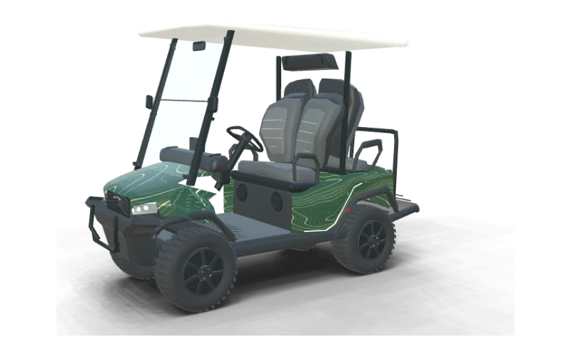 Bintelli Beyond 4PR Lifted | 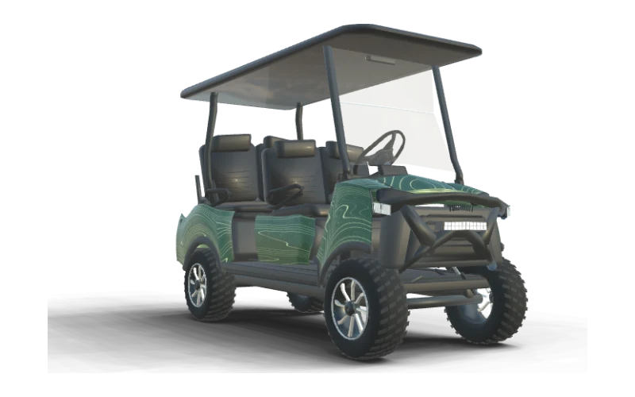 Denago EV Rover XL |

## Files

| File | 内容 |
|---|---|
| [MODELS.md](MODELS.md) | ブランド別のボディ構成 |
| [models.json](models.json) | 34車種の公開参照データ |
| [index.html](index.html) | ブランド絞り込みと検索に対応する GitHub Pages の資料 |
| [models.go](models.go) | データを埋め込んだ検索機能付き Go パッケージ |

## 資料の範囲

このカタログは見た目とボディ構成の資料です。実寸、DPI仕様、生産用カットテンプレートは含みません。参照年式はパネルの互換性を保証する情報ではありません。

## Related

私は、オーナーが自分のカートでデザインを試せるように [Golf Cart Wraps](https://golfcart-wraps.com) を作りました。この資料でボディ形状を比較し、[3Dデザイナーで柄を試してみてください](https://golfcart-wraps.com/design?utm_source=github&utm_medium=referral&utm_campaign=open_reference)。

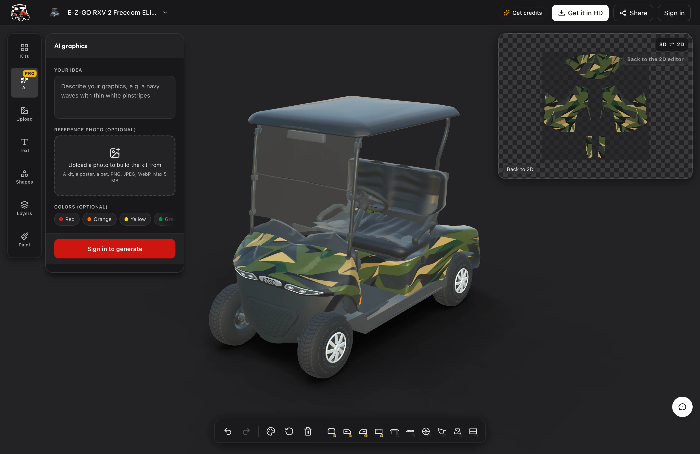

選択したカートで、柄、ボディパネル、表面の仕上げを比較できます。
