# Okleiny wózków golfowych: modele i nadwozia
[English](README.md) | [Deutsch](README.de.md) | [Français](README.fr.md) | [Italiano](README.it.md) | [Polski](README.pl.md) | [日本語](README.ja.md)

Porównaj 34 modele i konfiguracje wózków golfowych siedmiu marek. Układ siedzeń, wysokość, dostępne informacje o dachu i lata referencyjne pochodzą z katalogu. Uwzględniono połysk, mat, chrom i wykończenie holograficzne.

| | | | |
|:---:|:---:|:---:|:---:|
| 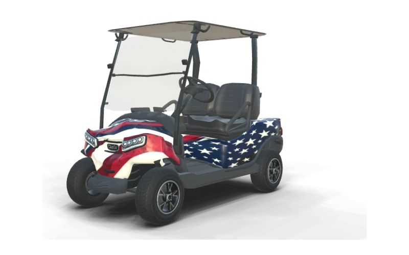 Club Car Onward 2 Passenger | 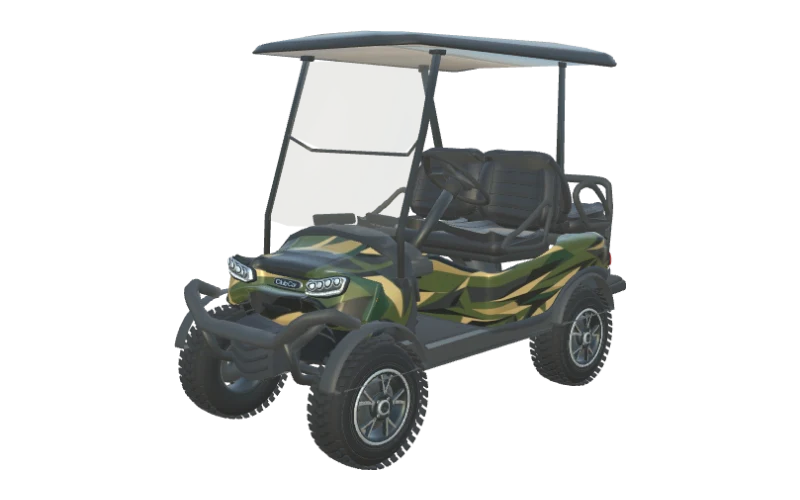 Club Car Onward Lifted 4 Passenger | 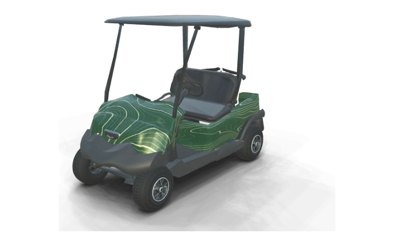 Club Car Tempo | 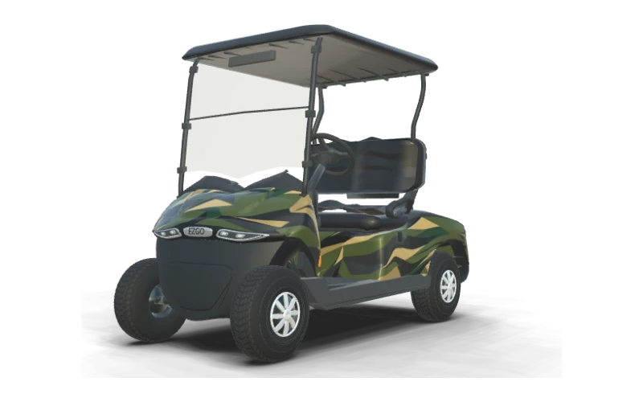 E-Z-GO RXV 2 Freedom ELiTE Lithium |
| 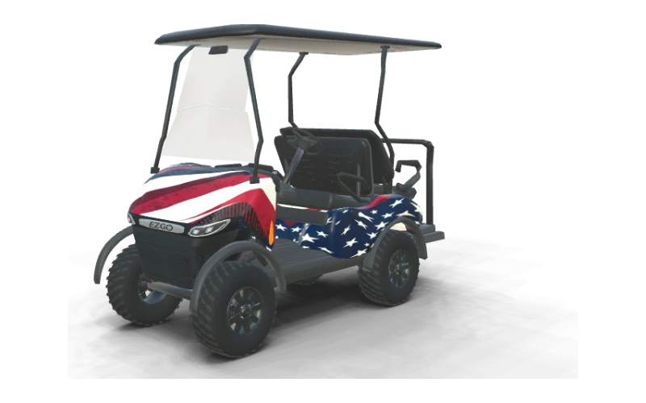 E-Z-GO RXV 4 Summit X ELiTE Lithium | 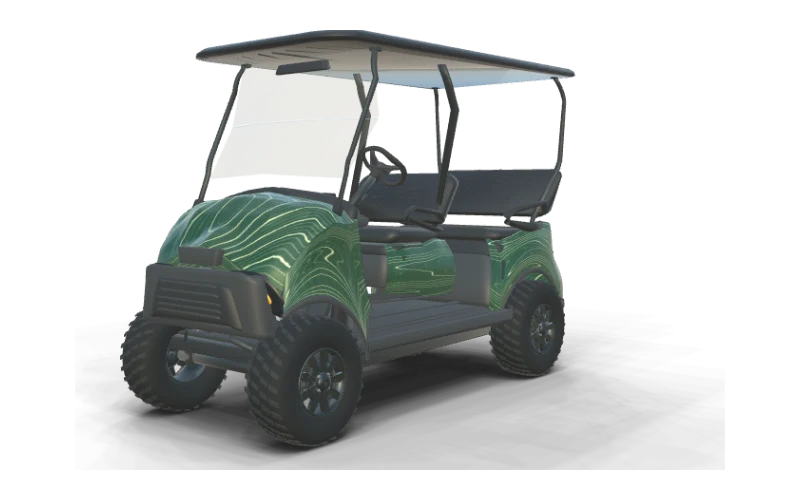 E-Z-GO Liberty Summit X ELiTE Lithium | 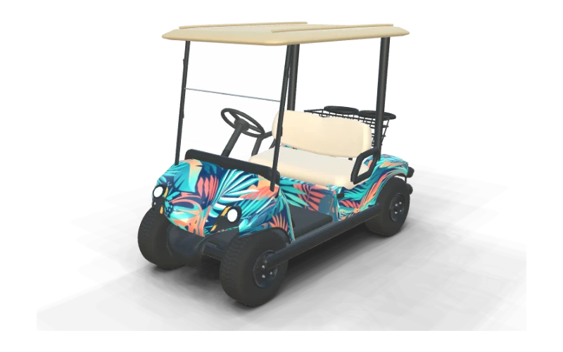 Yamaha Drive² PTV QuieTech EFI | 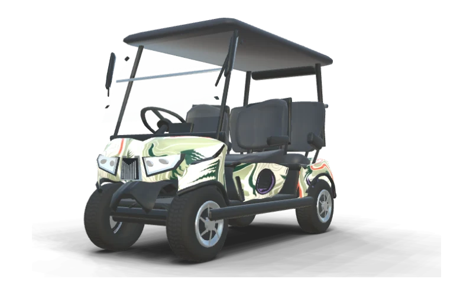 Evolution D5 Ranger 4 Plus |
| 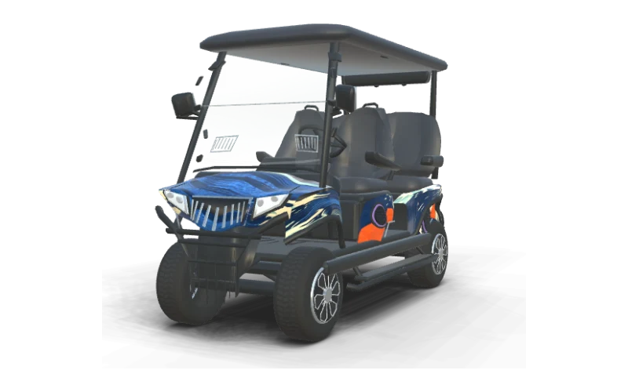 Evolution D5 Maverick 4 Plus | 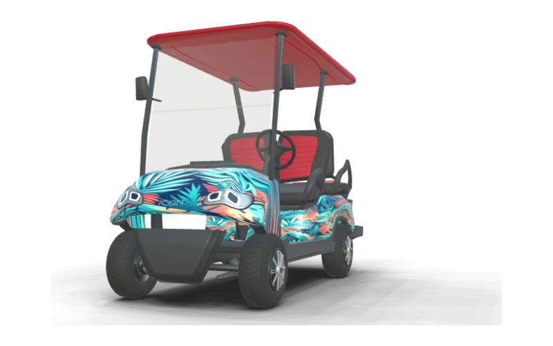 ICON i40 Standard | 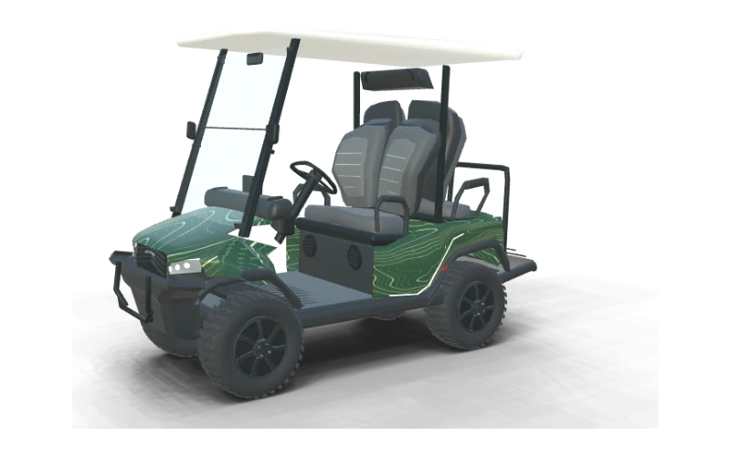 Bintelli Beyond 4PR Lifted | 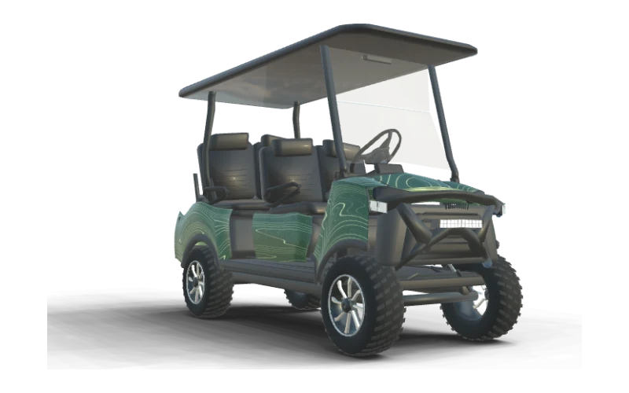 Denago EV Rover XL |

## Files

| File | Zawartość |
|---|---|
| [MODELS.md](MODELS.md) | Konfiguracje nadwozia według marki |
| [models.json](models.json) | Oczyszczony katalog 34 modeli |
| [index.html](index.html) | Interaktywny katalog GitHub Pages z filtrem marki i wyszukiwaniem |
| [models.go](models.go) | Pakiet Go z osadzonymi danymi i funkcjami wyszukiwania |

## Zakres danych

Katalog opisuje wygląd i konfigurację nadwozia. Nie zawiera wymiarów fizycznych, specyfikacji DPI ani szablonów cięcia produkcyjnego. Lata referencyjne nie potwierdzają zamienności paneli.

## Related

Stworzyłem [Golf Cart Wraps](https://golfcart-wraps.com), aby właściciele mogli sprawdzać grafikę na swoim wózku. Porównaj nadwozia i [wypróbuj wzór w projektancie 3D](https://golfcart-wraps.com/design?utm_source=github&utm_medium=referral&utm_campaign=open_reference).

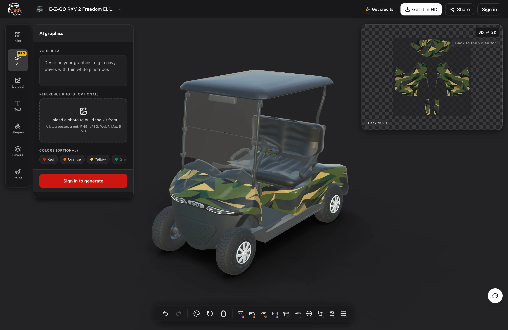

Porównuj grafikę, panele i wykończenia na wybranym wózku.

## Elsewhere

**Packages:** [Go Packages](https://pkg.go.dev/github.com/dirt-bike-graphics/golf-cart-wraps) | [npm](https://www.npmjs.com/package/golf-cart-wrap-models) | [PyPI](https://pypi.org/project/golf-cart-wrap-models/) | [JSR](https://jsr.io/@custom-graphics/golf-cart-wrap-models) | [Packagist](https://packagist.org/packages/custom-graphics/golf-cart-wraps) | [Open VSX](https://open-vsx.org/extension/custom-graphics-ref/golf-cart-wraps-reference) | [RubyGems](https://rubygems.org/gems/golf_cart_wrap_models) | [Hex.pm](https://hex.pm/packages/golf_cart_wrap_models) | [HexDocs](https://hexdocs.pm/golf_cart_wrap_models/index.html)

**Datasets:** [Hugging Face Dataset](https://huggingface.co/datasets/customdirtbikegraphics/golf-cart-wrap-models) | [Kaggle](https://www.kaggle.com/datasets/cutecatsforyou/golf-cart-wrap-models) | [Zenodo DOI](https://zenodo.org/records/24421443)

**Guides:** [GitBook Docs](https://golf-cart-wraps.gitbook.io/golf-cart-wraps-docs/) | [Mintlify Docs](https://golf-cart-wraps.mintlify.app/) | [Dev.to Engineering Note](https://dev.to/customdirtbikegraphics/cataloging-34-golf-cart-body-styles-as-flat-json-for-wrap-panel-mapping-18fb)

**Demos:** [Hugging Face Static Space](https://huggingface.co/spaces/customdirtbikegraphics/golf-cart-wraps)
